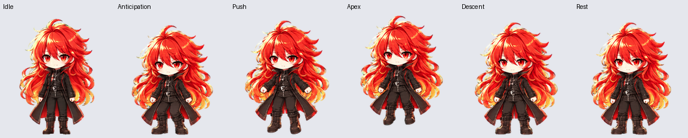

# 赤焰内置桌宠：挥手与跳跃优化

本次更新 Codex 内置的自定义赤焰，沿用原 ID
`pet_6abb898c7228819191b6e896f2538d5d`，保留原选中状态，没有新建桌宠。
仅替换第 3 行挥手和第 4 行跳跃；原有轻呼吸待机、左右移动、失败、等待、工作、检查和十六个看向动作均逐像素保留。

- 挥手采用同一只手连续抬起、摆动、放下，四帧脚底对齐待机基线 203。
- 跳跃采用较小幅度的蓄力、上升、腾空、下降、落地。峰值脚底升高 16 像素，落地回到基线 203。
- 落地站姿高度从旧版 170 像素改善到 190 像素，更接近待机的 196 像素，减少状态切换时突然缩小的感觉。
- 不修改客户端或播放逻辑；挥手仍为四帧、跳跃仍为五帧，不表示增加透明视频、随机动作调度或额外动作槽。




使用内置 ImageGen，以更新前下载的完整图集和待机单帧保持角色身份，分别生成完整动作横条。首次跳跃仍导致落地偏小，未采用；第二次明确缩小跳跃幅度。原始结果及实际提示词保留。
插件自带脚本负责拆帧、共享缩放、去溢色、图集结构、动作质量、方向连续性和预览验证。跳跃整行采用同一个几何变换，保留腾空位置，没有逐帧贴地或分别改变身高。

- `before.png`：本次开始时下载的实际安装图集。
- `decoded/`：采用的两条生成源横条；`jumping-rejected.png` 为未采用的首版。
- `jumping-prompt.txt`、`jumping-retry-prompt.txt`、`waving-prompt.txt`：实际使用的完整提示词。
- `chiyan-native-motion.webp`：已上传的最终静态 v2 图集；同名 PNG 为像素等价版本。
- `stored-readback.png`：更新后从服务器重新下载的图集，已逐像素核对。
- `previews/`：九种状态 GIF、全状态 GIF／MP4、十六方向循环和待机—跳跃衔接。
- `qa/official-preflight.json`：官方预检通过，73 个必需格均有效。
- `qa/pet-quality.json`：插件质量门禁通过，记录最终图集 SHA-256。
- `qa/self-check-stored.json`：包含服务器回读的完整检查结果。
- `qa/activation.json`：原 ID、名称和选中状态保留的记录，不包含临时下载链接。

Library 工具当前不可用，制作资料和预览保存在本项目中。重建需要 Python 3.10+、`../idle-six/requirements.txt` 的依赖和 work-pets 插件；可用 `WORK_PETS_SCRIPTS` 指定插件的 `skills/create-pet/scripts`。

```powershell
python animations/native-motion-2026-10-17/build.py
python animations/native-motion-2026-10-17/self_check.py --require-readback
```

脚本只重建与检查本地素材，不自动上传或切换宠物。服务器回读检查要求保留本次已核验的 `stored-readback.png`；未来再次更新后需通过 Pets 工具重新下载。
